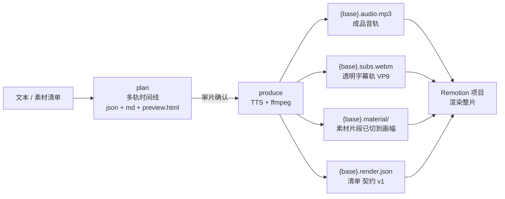

# text2video — 文本 → 音轨 + 字幕(中间件生产器)

把一段纯文本加工成**给视频渲染器消费的中间件**:一条成品音轨、一条**带透明通道的字幕轨**、
按时间线预切好的素材片段,以及一份声明式的 **render.json** 清单。
画面(铺素材 / 画标注框 / 出成片)交给独立的 Remotion 项目渲染,本项目**不再自己合成整片**。

**ffmpeg 在本项目的定位**:中间件生产器 —— 只负责探测(ffprobe)、裁切转码、BGM 混音、
把 ASS 烧到透明画布上;不做整片画面合成。

**两阶段工作流**:先产出一份**人类可读的多轨时间线**(语音 / 字幕 / 素材 / 画面按时间对齐,
可单独查看),审查确认后再产出中间件。审片在前、产出在后,改稿不必重跑昂贵的合成。



## 安装

依赖:Python 3.12+,以及 **FFmpeg**(未安装可 `winget install Gyan.FFmpeg`;或用环境变量
`FFMPEG_BIN` 指定路径)。ffmpeg 需带 `libvpx-vp9`(透明字幕轨)与 `libass`(烧字幕),
并建议 ≥ 6.1(BGM 混音用到 `amix normalize=0`)。

```bash
uv sync                    # 安装依赖(edge-tts、pytest)
uv run text2video doctor   # 自检:ffmpeg/ffprobe/VP9 透明编码/字体/edge-tts/SAPI/缓存/配置
```

## 两阶段工作流(推荐)

### 阶段 1:plan —— 生成时间线,审片

```bash
# 默认离线估算时间轴(不联网、秒出);产物三件套落在输出目录
uv run text2video plan --file examples/sample.txt --out out/sample

#   out/sample.preview.html    可视化时间线(多轨对齐,可逐轨开关;播放 MP3 时同步高亮)
#   out/sample.timeline.md     文本分镜表(按轨分节,只读报告)
#   out/sample.timeline.json   结构化数据(单一事实源,可 git diff;produce 只消费它)
```

审片要点:语音 / 字幕逐句是否对齐、断行是否合理、素材窗口与总时长是否合适。
**一致性自检**(`✅ 全部通过 / ❌ 问题列表`)会拦截明显错误。

> 估算轴用于审内容与布局;真实 edge-tts 的逐字节奏由 produce 阶段负责并对齐。
> 需要带音频预览真实节奏可加 `--real`(联网)。

### 阶段 2:produce —— 产出中间件

```bash
# 从 timeline.json 读全部参数,产出发给 Remotion 的中间件
uv run text2video produce --timeline out/sample.timeline.json
# → out/sample.audio.mp3 / .subs.webm / .material/ / .render.json
#   并刷新 .timeline.json(v5,逐字轴落盘)/ .timeline.md / .preview.html
```

- produce 只消费 timeline.json,**不重新做排版决策**(审的就是产出的);
- 产出前再次自检,失败默认**拒绝**(`--force` 可跳过,不推荐);
- 产出后把三件套**刷新为真实时间轴**,并打印"估算 vs 实际"语音轨偏差表。

### 一键用法(不先审片)

```bash
# 直接传文案 / 读文件(等价于"建真实时间轴 + produce"一步完成)
uv run text2video --text "你好,这是第一条文案。字幕会跟着语音逐字点亮。"
uv run text2video --file examples/sample.txt --out out/sample
uv run text2video produce --file examples/sample.txt --out out/sample   # 同上,显式写法
# 也可以 python -m text2video ...
```

## produce 的产物

设 `--out`(或 `--timeline` 推导)的基名为 `{base}`:

| 产物 | 内容 | 消费方 |
| --- | --- | --- |
| `{base}.audio.mp3` | 成品音轨(逐句 TTS 连续合成;**有 BGM 时已按 volume+apad+amix normalize=0 混好**) | Remotion `<Audio>` |
| `{base}.subs.webm` | **透明字幕轨**:ASS 烧到 alpha 画布,VP9 / `pix_fmt=yuva420p`,画幅与 fps = 输出画幅/fps,帧数 = `durationInFrames` | Remotion `<OffthreadVideo transparent>` |
| `{base}.material/` | 素材片段:按 timeline 素材段裁好(video 用 trim in/out;image/video 按 crop 像素窗口切→scale 到输出画幅)。video 出 h264 **无音轨** mp4,image 出 png | Remotion 逐段铺满 |
| `{base}.render.json` | 给 Remotion 的清单(冻结契约 version 1,见下表) | Remotion 读清单 |
| `{base}.ass` | 字幕源文件(纯文本,便于比对/重烧) | 人工核对 |
| `{base}.timeline.json` / `.timeline.md` / `.preview.html` | 真实时间轴版三件套(含逐字轴) | 人工复核 |

素材中间件命名:`m{序号:02d}_{素材id}.{png|mp4}`,例如 `m00_counter.png`。
重跑时只清理符合该命名的旧文件(不动目录里的其他文件);没有素材段时不建空目录。

## render.json 字段表(冻结契约 version 1)

字段名**一字不改**;时间单位秒(float,round 3);路径一律**绝对路径**(Windows 反斜杠原样)。

| 字段 | 类型 | 说明 |
| --- | --- | --- |
| `version` | int | 契约版本,当前恒为 `1` |
| `fps` | int | 输出帧率(与 `meta.fps` 一致,默认 60) |
| `width` / `height` | int | 输出画幅(px);字幕轨画幅与之相同 |
| `duration` | float | 成品音轨实测时长(秒,round 3) |
| `durationInFrames` | int | `round(duration * fps)`,即 Composition 的帧数 |
| `background` | object | `{"type":"color","color":"1B1B2A"}`(**不带** `0x`/`#`)或 `{"type":"image","path":"<绝对路径>"}` |
| `audio.path` | string | 成品音轨绝对路径;文件缺失/为空时给 `""`(消费端跳过该轨) |
| `subtitle.path` | string | 透明字幕轨绝对路径;同上,空串表示不挂字幕轨 |
| `materials[]` | array | 每项 `{"type":"image" or "video","path":绝对路径,"start":秒,"end":秒,"fade":{"in":秒,"out":秒}}`;**素材已预切到输出画幅**,消费端只需铺满 + 淡入淡出(无需 in/out、无需 crop) |
| `annotations[]` | array | 每项 `{"start","end","x","y","w","h","color"}`,坐标/尺寸为画幅比例(0~1),`color` 为 `0xRRGGBB`(缺省补 `0xFF3B30`) |
| `timing.mode` | string | `"real"`(produce 产出的永远是真实轴) |

**层级约定**(与旧 ffmpeg 合成一致):素材 → 标注框 → 字幕(字幕最上)。
**BGM**:已混进 `audio.path` 单轨,清单里不再有 bgm 字段 —— 消费端不要二次混音。

清单样例(方形、无素材、一个标注框):

```json
{
  "version": 1,
  "fps": 60, "width": 1080, "height": 1080,
  "duration": 24.168, "durationInFrames": 1450,
  "background": {"type": "color", "color": "1B1B2A"},
  "audio": {"path": "C:\\out\\sample.audio.mp3"},
  "subtitle": {"path": "C:\\out\\sample.subs.webm"},
  "materials": [],
  "annotations": [
    {"start": 17.5, "end": 24.5, "x": 0.1, "y": 0.3, "w": 0.8, "h": 0.55,
     "color": "0xFF3B30"}
  ],
  "timing": {"mode": "real"}
}
```

## 与 Remotion 渲染端的配合

画面不在这里合成:本项目只产中间件,整片由独立的 Remotion 工程渲染。

- 渲染端绝对路径:`C:\Users\MLTZ\Desktop\code\working\remotion-video`
- 契约与用法看该目录的 `README.md`(§2 清单契约、§3 静态资源规则、§8 联调约束)

一条可复制的命令(在渲染端目录里执行):

```powershell
cd C:\Users\MLTZ\Desktop\code\working\remotion-video
node render.mjs --manifest "C:\Users\MLTZ\Desktop\code\working\text2video\out\sample.render.json" --out out\sample.mp4

# 整片很慢,先出几帧校对:
node render.mjs --manifest "C:\Users\MLTZ\Desktop\code\working\text2video\out\sample.render.json" --stills 120,720,1380 --stills-dir out\check
```

**fps / 画幅一致性**(跨项目唯一容易踩的约束):

- 清单里的 `width` / `height` / `fps` 是**唯一权威**:`{base}.subs.webm` 按它烧,`{base}.material/*` 按它裁;
  渲染端不再缩放,只按清单尺寸叠层。
- 三者不一致时画面会被**拉伸**(字幕轨整幅叠)或**重复/丢帧**(素材帧率),所以改画幅或帧率必须
  **重跑 produce**,不要手改清单里的这几项。
- 渲染端 `render.mjs` 会用 ffprobe 复核字幕轨与视频素材的宽高/帧率,不一致时**告警**(不中断),
  日志里会指明是哪一项 —— 看到这类告警就是清单和中间件对不上了。
- `durationInFrames = round(duration * fps)`;成片帧数以此为准,`duration` 只用于对账
  (两者最多差 1 帧,属帧化取整)。

## 透明字幕轨(subs.webm)的编码与透明通道约定

透明底三步**缺一不可**(缺任一步 alpha 恒为 255,叠上去就是一块黑):

```text
1) 画布:color=c=black:s=WxH:r=FPS:d=DUR  ->  format=rgba    (带上 alpha 通道)
2) 压透明:colorchannelmixer=aa=0                             (整幅 alpha 显式压成 0)
3) 烧字幕:subtitles=xxx.ass:alpha=1                          (默认 false 不处理 alpha)
编码:libvpx-vp9 -pix_fmt yuva420p -auto-alt-ref 0 -b:v 0 -crf 30 -row-mt 1
帧数:-frames:v round(DUR*FPS)                                (与 durationInFrames 对齐)
```

实际命令(在输出目录内执行;字体文件单独放一个子目录供 `fontsdir`,用完即删):

```bash
ffmpeg -y -hide_banner -loglevel error \
  -f lavfi -i "color=c=black:s=1080x1080:r=60:d=24.168" \
  -vf "format=rgba,colorchannelmixer=aa=0,subtitles=sample.ass:fontsdir=sample.fonts:alpha=1" \
  -frames:v 1450 \
  -c:v libvpx-vp9 -pix_fmt yuva420p -auto-alt-ref 0 -b:v 0 -crf 30 -row-mt 1 -cpu-used 4 \
  sample.subs.webm
```

约定与坑:

- **WebM 的 alpha 不占主画面 pix_fmt**:ffprobe 读该流仍然是 `pix_fmt=yuv420p`,透明信息
  另存为一条 alpha 平面,并由容器级 `TAG:alpha_mode=1` 标记。**判"有没有透明"只看这个标记**;
  produce 产出后会自检该标记,缺失直接报错(不静默产坏文件)。
- **ffmpeg 原生 VP9 解码器会静默丢 alpha**(解出来 alpha 恒 255,容易误判成"字幕是黑块")。
  本地校验必须显式用 libvpx 解码:

```bash
# 逐帧 alpha 统计:min 应为 0(背景全透明),max 应为 255(字形不透明)
ffmpeg -c:v libvpx-vp9 -ss 2.0 -i out/sample.subs.webm -frames:v 1 \
  -f rawvideo -pix_fmt rgba - | python -c "import sys;a=sys.stdin.buffer.read()[3::4];print(min(a),max(a))"

# 叠到纯色背景上导一张 PNG(人眼验证"字不透明、背景透出")
ffmpeg -y -ss 2.0 -c:v libvpx-vp9 -i out/sample.subs.webm \
  -f lavfi -i "color=c=0x2E7D32:s=1080x1080:r=60" \
  -filter_complex "[1:v]format=rgba[bg];[0:v]format=rgba[fg];[bg][fg]overlay=0:0,format=rgb24" \
  -frames:v 1 -update 1 out/sample.subs_preview.png
```

> 注意 `overlay` 的两条输入都要 `format=rgba`:若背景是 `yuv420p`、
> `overlay=format=auto`,会把前景转成不带 alpha 的格式,alpha 同样被丢掉。

- 字幕轨**从第 0 帧开始**覆盖到最后一帧,时长/帧数与清单一致;消费端整幅同尺寸叠加即可
  (`<OffthreadVideo transparent>`,不做缩放)。
- 文件名(含基名与素材 id)请避开 `#`、`?`、`&` —— 部分消费端用 `staticFile()` 时会
  二次 URL 编码;素材 id 里的这些字符在中间件命名时已被替换成 `_`。

## 常用选项

子命令 `plan` / `produce` / 一键用法共用下列参数(`produce --timeline` 时以 timeline 为准):

| 选项 | 默认 | 说明 |
| --- | --- | --- |
| `--file` / `--text` / `--stdin` | 必选其一 | 文本来源 |
| `--out` | `output` | **产物基名**:产物为 `{基名}.render.json` / `.audio.mp3` / `.subs.webm` / `.material/` 等 |
| `--materials JSON` | 无 | 素材清单(素材轨 + BGM,见下文) |
| `--voice` | `zh-CN-XiaoxiaoNeural` | 音色(`--list-voices` 查看,如 `zh-CN-YunxiNeural` 男声) |
| `--rate` `--volume` `--pitch` | `+0` `+0` `+0Hz` | 语速 / 音量 / 音调 |
| `--style karaoke or scroll` | `karaoke` | 字幕样式:逐字点亮 / 整段上滚 |
| `--landscape` / `--portrait` / `--square` | `square` | 画幅预设 16:9(1920x1080)/ 9:16(1080x1920)/ 1:1(1080x1080);显式 `--width/--height` 优先 |
| `--width` `--height` | 按预设 | 画幅(px) |
| `--fps` | `60` | 帧率(写进清单;字幕轨与素材 mp4 都按此帧率规整) |
| `--transition SEC` | `0` | 素材段淡入淡出时长(写进清单 `fade`,每段内部钳到段长一半;0=硬切) |
| `--bg-color RRGGBB` | `1B1B2A` | 纯色背景(清单 `background.color`,不带 0x) |
| `--bg-image path` | 无 | 背景图(清单给绝对路径,由消费端铺满) |
| `--font` `--font-size` | 自动 / 短边÷20 | 字体家族;字号默认=画面短边÷20 向下取整(1080²→54px) |
| `--highlight-color` `--dim-color` | `0xFFFFFF` `0x9A9A9A` | 已念 / 未念颜色 |
| `--margin-v` `--outline` `--shadow` `--box` | 140 / 3 / 1 / 关 | 字幕距底、描边、阴影、半透明底色框 |
| `--max-chars` | 自动 | 一行最多中文数 |
| `--crf` `--preset` | `23` / `medium` | **素材视频中间件**的 x264 参数 |
| `--audio-bitrate` | `192k` | 成品音轨 mp3 码率 |
| `--tts-backend edge or sapi or auto` | `auto` | 语音引擎:edge=联网 edge-tts;sapi=Windows 本地语音(离线,逐字轴近似);auto=优先 edge,失败回退 sapi |
| `--tts-cache-dir PATH` | `%LOCALAPPDATA%\text2video\tts_cache` | TTS 缓存目录(同参数只联网一次) |
| `--no-tts-cache` | 关 | 禁用 TTS 缓存 |
| `--config PATH` | 无 | TOML 配置文件(默认查找当前目录 `text2video.toml`) |

`plan` 专用:`--real`(联网真实时间轴)。
`produce` 专用:`--timeline XXX.json`(与 `--text/--file` 二选一)、`--force`(忽略自检强制产出)。

### 配置文件(text2video.toml)

把常用参数写进 TOML(键与 CLI 参数同名,下划线式),命令行显式参数优先:

```toml
[text2video]
voice = "zh-CN-XiaoxiaoNeural"
bg_color = "1B1B2A"
width = 1920
height = 1080
transition = 0.3
tts_backend = "auto"
```

默认读取当前目录 `text2video.toml`;`--config PATH` 显式指定。

### 封面图(text2video cover)

封面仍是**单帧 PNG**(画面交给 Remotion 后,封面仍由本项目出图,做片头/封面图用):

```bash
uv run text2video cover --timeline out/sample.timeline.json --title "标题" --subtitle "副标题" --out out/sample_cover.png
uv run text2video cover --text "文案……" --title "标题" --landscape --out out/cover.png
```

### 环境诊断(text2video doctor)

```bash
uv run text2video doctor            # ffmpeg/ffprobe/VP9 透明编码/字体/edge-tts/SAPI/缓存目录/配置
uv run text2video doctor --online   # 额外测 edge-tts 网络连通
```

## 素材轨与背景音乐(materials.json)

`plan` / `produce` 加 `--materials materials.json`,即可按段落覆盖视频/图片素材并混入
背景音乐(示例见 `examples/materials.sample.json`,素材路径相对该文件所在目录):

```json
{
  "assets": [
    {"id": "clip",  "path": "clips/intro.mp4", "type": "video"},
    {"id": "pic",   "path": "images/bg.png",   "type": "image"},
    {"id": "music", "path": "audio/bgm.mp3",   "type": "audio"}
  ],
  "material": [
    {"start": 0.0, "end": 3.0, "asset": "clip", "in": 5.0, "out": 8.0,
     "crop": {"x": 0.5, "y": 0.0}},
    {"start": 3.0, "end": 8.0, "asset": "pic"}
  ],
  "bgm": {"asset": "music", "volume": 0.3},
  "annotations": [
    {"start": 4.0, "end": 7.0, "x": 0.1, "y": 0.2, "w": 0.5, "h": 0.4,
     "color": "0xFFFFFF"}
  ]
}
```

- `material` 段:在时间线 `start..end` 区间铺满画幅;视频段用 `in/out` 指明素材内裁剪区间
  (**裁剪长度须与区间长度一致**,容差 0.1s),图片段无需 `in/out`;未覆盖区间露出背景。
- **画面裁剪**(`crop`,图片/视频均可,可选):`{"x", "y"}` 是"cover 满幅 + 单轴滑动"的窗口位置。
  素材等比放大到一条边贴满画幅(无黑边),窗口比例恒等于画幅;`x`/`y`(0~1,默认 0.5 居中)
  只在素材**多出来的那条轴**上滑动(素材更宽 → `x` 左右滑;更高 → `y` 上下滑)。
  中间件按这个窗口**切好再放大到画幅**,所以消费端不需要 crop。旧版 `zoom` 已移除,出现即报错。
- **审片标注窗口**:`plan` 会对带 crop 的素材探测分辨率,把窗口相对素材的几何
  (`data.frame`)写进时间线,`preview.html` 在素材缩略图上用红框标出实际取用区。
- **画面标注框**(`annotations`,可选):落到清单 `annotations`,由消费端画框(旧版用 ffmpeg
  `drawbox` 6px 描边,层级在字幕之下)。
- `bgm`:音频素材低音量垫底(默认 0.25),产出时**预混进成品音轨**(需要 ffmpeg ≥ 6.1,
  `amix normalize=0` 避免配音被音量归一化削弱)。
- 素材段窗口按**绝对秒数**铺在时间线上,**不随 TTS 真实时长伸缩**:估算轴短于真实轴时素材
  覆盖开头、尾部露出背景属正常;真实轴显著短于估算时(超过自检容差)产出会被拒绝。

## 时间线中间产物(timeline.json,version 5)

```text
out/sample.timeline.json     # 单一事实源:meta + 源文本 + 多轨 + 素材库 + 标注框 + 自检结果
out/sample.timeline.md       # 文本分镜表:元信息 / 素材库 / 自检 / 各轨道 分节
out/sample.preview.html      # 自包含单文件多轨时间线浏览器(零依赖,双击即开)
```

### schema v5

| 键 | 类型 | 说明 |
| --- | --- | --- |
| `version` | int | 当前 `5`。v2 加 assets/bgm/material 轨;v3 素材段可带 `crop`;v4 去掉 `crop.zoom` 改 cover+单轴滑动、素材段加 `frame`、顶层加 `annotations`;**v5 语音段 `data.words` 内嵌逐字轴** |
| `meta` | object | 排版/编码参数(voice / rate / volume / pitch / width / height / fps / transition / tts_backend / bg_color / bg_image / style / font / font_size / max_chars / highlight_color / dim_color / outline / shadow / margin_v / box / crf / preset / audio_bitrate / timing_mode) |
| `text` | string | 源文案(含换行);分句由 `split_sentences` 现算 |
| `duration` | float | 总时长(秒,round 3);produce 后 = 成品音轨实测时长 |
| `tracks` | object | 固定 4 条:`speech` / `subtitle` / `visual` / `material` |
| `tracks.speech[]` | array | 每句一段 `{start,end,text,data}`,**`data.words` 为该句逐字轴** |
| `tracks.speech[].data.words[]` | array | `{"text": "你", "start": 0.1, "end": 0.238}` —— 逐字/逐词时间(秒,round 3),可直接驱动逐字点亮字幕 |
| `tracks.subtitle[]` | array | 与 `speech` 逐段同源(数量与文本一致);逐字轴不重复落盘,按段序对齐即可 |
| `tracks.visual[]` | array | 恒为单段,只描述画面(纯色 #1B1B2A / 背景图文件名),不参与产出决策 |
| `tracks.material[]` | array | 每段 `{start,end,text=素材id,data}`,`data` 可带 `in`/`out`(视频裁剪,秒)、`crop{x,y}`(0~1)、`frame{x,y,w,h}`(窗口相对素材几何,仅审片用) |
| `assets[]` | array | `[{id, path, type}]`,`path` 为**绝对路径**,`type` ∈ {video,image,audio} |
| `bgm` | object or null | `{asset, volume}`,`volume` ∈ (0,1],默认 0.25 |
| `annotations[]` | array | `[{start,end,x,y,w,h,color?}]`(比例 0~1 + `0xRRGGBB`) |
| `checks[]` | array of string | 一致性自检错误消息;空数组 = 全绿(产出放行依据) |

**向后兼容**:v2/v4 档可直接读(逐字轴为空,校验自动跳过),`produce` 会按 v5 重写成真实轴版本。
所有时间在 JSON 里统一 round 3;浮点噪声不会漏进清单。

## 旧 `render` 已移除(迁移对照)

整片画面合成路径已删除:**不再产出 mp4**,`--split-tracks`(纯画面/纯音频)与
`--skip-intermediate` 一并移除。对照:

| 旧用法 | 现在 |
| --- | --- |
| `text2video render --timeline x.timeline.json` | `text2video produce --timeline x.timeline.json` |
| `text2video --file a.txt --out out/a.mp4` | `text2video --file a.txt --out out/a`(产物基名,不带 .mp4) |
| 产物 `out/a.mp4`(ffmpeg 合成整片) | `out/a.render.json` 清单 + 音轨/字幕轨/素材片段,由 Remotion 出成片 |
| `--split-tracks` | 音轨/字幕轨本就是独立产物,不需要分离 |
| `--skip-intermediate` | 中间件(含 .ass)都是交付物,不再删除 |

## 文件说明

```text
src/text2video/
  cli.py        # 入口:plan / produce / cover / doctor 子命令 + 一键用法(+ 配置合并)
  config.py     # TOML 配置文件加载(text2video.toml,命令行优先级最高)
  tts.py        # edge-tts 合成语音 + 逐字时间轴 + 缓存 + 指数退避重试
  tts_local.py  # SAPI(Windows 本地语音)离线合成 + 逐字事件解析/估算降级
  timeline.py   # 多轨时间线模型(v5 逐字轴)+ 素材清单解析/校验 + 估算轴 + 一致性自检
  report.py     # timeline -> markdown 分镜表 + 自包含 preview.html
  layout.py     # 字体/字号/每行字数的纯计算(plan 与 produce 共用,保证一致)
  produce.py    # produce:真实 TTS -> 音轨 / 透明字幕轨 / 素材中间件 / render.json
  subs.py       # 时间轴 -> ASS 字幕(纯函数,两种样式;封面共用头部模板)
  compose.py    # ffmpeg 中间件命令:字幕烧 alpha 画布、素材裁切、BGM 混音、探测
  cover.py      # 封面图:标题 ASS + 单帧渲染 PNG(16:9 默认)
  doctor.py     # 环境诊断(doctor 子命令,逐项 PASS/WARN/FAIL)
tests/          # subs/timeline/report/compose/produce/config/cover/doctor/tts 单测 + cli 回归
examples/sample.txt               # 示例文案
examples/materials.sample.json    # 素材清单模板(素材轨 + BGM)
```

## 已知说明

- **TTS 缓存**:同参数(文本+音色+语速音量音调)合成结果缓存于
  `%LOCALAPPDATA%\text2video\tts_cache`(可 `--tts-cache-dir` 改、`--no-tts-cache` 关);
  命中时 produce 跳过联网合成。edge-tts 版本变化不影响命中(缓存不掺版本),
  但 **edge-tts 必须 ≥ 7.3.1**(更早版本对微软接口一律 403)。
- **网络重试**:edge-tts 合成失败自动重试(最多 3 次,间隔 1s/2s);`--tts-backend auto`
  在第 3 次失败后回退本地 SAPI 并告警,`edge` 时直接抛出。
- **SAPI 本地语音**(`--tts-backend sapi`):走 Windows System.Speech,零新增依赖、完全离线;
  逐字轴精度依赖系统语音包,实测 Huihui Desktop 的事件不可靠时会自动降级为
  "估算轴 × 实测时长"缩放(逐字点亮为近似)。建议只作断网兜底。
- **音轨规格**:edge-tts 的 mp3 原样保留(实测 24 kHz 单声道),BGM 混音/转码后仍是 mp3;
  消费端不要再做二次混音。
- **字幕字体**:默认用系统中文字体(Windows 为"微软雅黑");烧字幕时把字体文件复制到输出
  目录下的临时子目录(`{base}.fonts/`)供 libass 加载,用完即删。Linux/macOS 上优先
  `Noto Sans CJK`,找不到时回退系统默认并告警。
- **字幕样式**:默认白字 + 黑色描边(3px)+ 1px 深投影,无背景框;`--box` 加半透明底框。
  逐字点亮来自 edge-tts 的 WordBoundary:中文实测**单字级**,英文为单词级。
- **scroll 走字幕**:ffmpeg 集成的 libass 对屏幕外 `\move`/深负偏移有缺陷,改为逐行 `\pos`
  分片模拟匀速滚动(视觉等价);字幕轨同样按此烧制。
- **估算 vs 真实**:估算轴按语速均分 token,实测比真实轴整体偏慢约 1s(中文含句间停顿);
  审布局/总时长随之留有余量,最终对齐以 produce 的真实轴为准。
