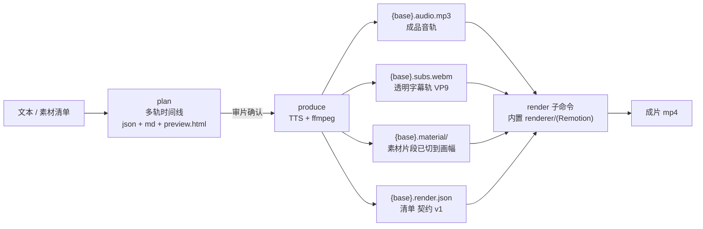
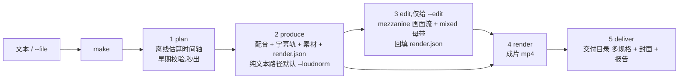
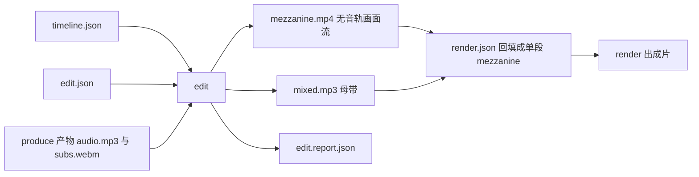

# text2video — 文本 → 中间件 → Remotion 成片(一条流水线)

一条仓库跑完整条流水线:**文本 → 中间件 → 成片**。Python 侧(本项目主体)把纯文本加工成
**给渲染器消费的中间件**——一条成品音轨、一条**带透明通道的字幕轨**、按时间线预切好的素材片段,
以及一份声明式的 **render.json** 清单;渲染端的 Remotion 工程(**`renderer/`**,原独立仓库
`remotion-video` 已并入本仓库)按清单出片,命令是 `text2video render`。
画面(铺素材 / 画标注框 / 出成片)只由 `renderer/` 负责,Python 侧**不自己合成整片**。

**ffmpeg 在本项目的定位**:中间件生产器 —— 只负责探测(ffprobe)、裁切转码、BGM 混音、
把 ASS 烧到透明画布上;不做整片画面合成。

**两阶段工作流**:先产出一份**人类可读的多轨时间线**(语音 / 字幕 / 素材 / 画面按时间对齐,
可单独查看),审查确认后再产出中间件。审片在前、产出在后,改稿不必重跑昂贵的合成。



## 安装

依赖:Python 3.12+,以及 **FFmpeg**(未安装可 `winget install Gyan.FFmpeg`;或用环境变量
`FFMPEG_BIN` 指定路径)。ffmpeg 需带 `libvpx-vp9`(透明字幕轨)与 `libass`(烧字幕),
并建议 ≥ 6.1(BGM 混音用到 `amix normalize=0`)。

```bash
uv sync                    # 安装依赖(edge-tts、pytest)
uv run text2video doctor   # 自检:ffmpeg/ffprobe/VP9 透明编码/字体/edge-tts/SAPI/缓存/配置
```

**出片另需 Node.js**(只需 `render`,plan/produce/cover 都不需要):本机实测 Node **v24.13.0**;
渲染端依赖已随 `renderer/node_modules` 就位,丢了就在 `renderer/` 里
`npm ci --registry=https://registry.npmmirror.com` 重建(实测 22 s)。

## 项目结构

```text
text2video/
  src/text2video/    Python 生产端:plan / produce / edit / render / deliver / make / cover / doctor
                     (见「文件说明」)
  tests/             Python 单测(pytest,不联网)
  renderer/          Remotion 渲染端(原独立仓库 remotion-video 并入):
                     render.mjs 是出片主入口,Remotion 组件在 renderer/src/
                     契约、静态资源规则、本机坑、验收记录 → renderer/README.md
  examples/          示例文案与素材清单
  out/               产物(中间件 / 时间线 / 静帧,已在 .gitignore)
```

两侧的唯一接口是 **render.json 清单**:Python 侧只管产出清单与素材文件,渲染端只管按清单出片,
互不 import、互不修改对方代码。

## 两阶段工作流(推荐)

### 阶段 1:plan —— 生成时间线,审片

```bash
# 默认离线估算时间轴(不联网、秒出);产物三件套落在输出目录
uv run text2video plan --file examples/sample.txt --out out/sample

#   out/sample.preview.html    可视化时间线(多轨对齐,可逐轨开关;播放 MP3 时同步高亮)
#   out/sample.timeline.md     文本分镜表(按轨分节,只读报告)
#   out/sample.timeline.json   结构化数据(单一事实源,可 git diff;produce 只消费它)
```

审片要点:语音 / 字幕逐句是否对齐、断行是否合理、素材窗口与总时长是否合适。
**一致性自检**(`✅ 全部通过 / ❌ 问题列表`)会拦截明显错误。

> 估算轴用于审内容与布局;真实 edge-tts 的逐字节奏由 produce 阶段负责并对齐。
> 需要带音频预览真实节奏可加 `--real`(联网)。

### 阶段 2:produce —— 产出中间件

```bash
# 从 timeline.json 读全部参数,产出发给 Remotion 的中间件
uv run text2video produce --timeline out/sample.timeline.json
# → out/sample.audio.mp3 / .subs.webm / .material/ / .render.json
#   并刷新 .timeline.json(v5,逐字轴落盘)/ .timeline.md / .preview.html
```

- produce 只消费 timeline.json,**不重新做排版决策**(审的就是产出的);
- 产出前再次自检,失败默认**拒绝**(`--force` 可跳过,不推荐);
- 产出后把三件套**刷新为真实时间轴**,并打印"估算 vs 实际"语音轨偏差表。

### 一键用法(不先审片)

```bash
# 直接传文案 / 读文件(等价于"建真实时间轴 + produce"一步完成)
uv run text2video --text "你好,这是第一条文案。字幕会跟着语音逐字点亮。"
uv run text2video --file examples/sample.txt --out out/sample
uv run text2video produce --file examples/sample.txt --out out/sample   # 同上,显式写法
# 也可以 python -m text2video ...
```

## 一键:make(五个阶段串成一条命令)

`make` 把 `plan → produce → edit(可选)→ render → deliver` 串起来:它只做**编排与参数传递**,
每个阶段仍是原来那条子命令(参数同名同义),任一阶段失败立即停止并报出阶段名与可读原因。



```powershell
# 纯文本一条命令:plan → produce(自动 --loudnorm)→ render → deliver
uv run text2video make --file examples/sample.txt --out out/make_sample `
  --specs landscape,portrait,square --cover-at 1.0

# 带剪辑层:多一步 edit(母带自己把响度做到 -14 LUFS,produce 不再加 loudnorm)
uv run text2video make --file script.txt --edit edit.json --out out/make_edit --landscape --fps 30
```

进度是一行一阶段(阶段自己的日志跟在下面),最后打印产物总表(下面耗时是本机实测,
1080² @60fps / 1450 帧的样例):

```text
[1/5] plan …
  完成 0.2s → out\make_sample.timeline.json + .timeline.md + .preview.html
[2/5] produce …
  完成 17.3s → out\make_sample.audio.mp3 + .subs.webm + .render.json
[3/5] edit 跳过(未给 --edit,纯文本路径不需要剪辑层)
[4/5] render …
  完成 133.2s → out\make_sample.mp4
[5/5] deliver …
  完成 7.2s → out\make_sample.deliver
产物总表:
  成片    …\out\make_sample.mp4
  多规格  …\out\make_sample.deliver\make_sample-landscape.mp4
  …
```

产物(基名 `{base}` = `--out` 的绝对路径,扩展名会被剥掉):

| 产物 | 由哪个阶段产出 |
| --- | --- |
| `{base}.mp4` | render(成片) |
| `{base}.deliver/{stem}-{spec}.mp4` | deliver(多规格:landscape / portrait / square) |
| `{base}.deliver/cover-NN-Xs.png` | deliver(封面抽帧) |
| `{base}.deliver/deliver.report.md` | deliver(响度复核 + 音画对位 + 规格表) |
| `{base}.audio.mp3` / `.subs.webm` / `.material/` / `.render.json` / `.srt` / `.vtt` | produce |
| `{base}.mezzanine.mp4` / `.mixed.mp3` / `.edit.report.json` | edit(仅 `--edit`) |
| `{base}.timeline.json` / `.timeline.md` / `.preview.html` | plan(估算轴)→ produce(真实轴刷新) |

参数表:

| 参数 | 默认 | 说明 |
| --- | --- | --- |
| `--file` / `--text` / `--stdin` | — | 文本来源(三选一,同 produce;plan+produce 都被跳过时可省) |
| `--out BASE` | `output` | 产物基名 |
| `--edit JSON` | 关 | 给了才跑 edit 阶段(它先回填 render.json,再由 render 出片) |
| `--specs LIST` | `landscape,portrait,square` | 透传 deliver:要交付的规格 |
| `--cover-at LIST` | `1.0` | 透传 deliver:封面时间点(>=1 按秒,0~1 按全片比例) |
| `--fit blur\|crop` | `blur` | 透传 deliver:竖/方规格的画面适配 |
| `--skip LIST` | 空 | 跳过阶段:`plan,produce,edit,render,deliver` |
| `--force` | 关 | produce = 忽略一致性自检;edit = 允许覆盖上一轮画面流/母带 |
| `--loudnorm` | 自动 | produce 的音轨响度母带:无 `--edit` 自动开、有 `--edit` 自动关 |
| `--target-lufs` / `--true-peak` | `-14` / `-1.5` | 同时作为 produce 的母带目标与 deliver 的复核目标 |
| `--sync-tolerance` | `0.25` | 透传 deliver:音画对位偏差阈值(秒) |
| 画幅 / 字体 / 语音 / `--materials` / `--crf` / `--preset` … | 同 produce | 与 produce 同名同义(共同参数集) |

与分步子命令的关系:

- 每个阶段就是原来那条命令,`make` 只负责顺序与传参;想单独看某一步的细节,直接跑那条子命令,
  产物完全一致(命令里都是绝对路径,不依赖当前目录);
- `--skip` 用来补跑:`make --out out/make_sample --skip plan,produce` = 只重跑 render + deliver
  (此时不需要文本来源);
- `--edit` 与 `--skip edit` 互斥:给了清单却跳过 edit 会让 render 读到 produce 的旧清单,直接报错;
- 交付规格的重编码用 deliver 自己的默认(x264 crf 20);`make --crf/--preset` 只作用于 produce 的
  素材中间件;
- 跳过 produce 时 render 会检查 `{base}.render.json` 是否存在,跳过 render 时 deliver 会检查成片 ——
  缺了就报"找不到清单/成片"而不是继续跑出空产物;
- 重跑带 `--edit` 的 make 要加 `--force`(edit 默认拒绝覆盖上一轮画面流/母带,与单独跑 edit 一致)。

### 响度:--loudnorm(produce 的母带开关)

- 背景:edge-tts 直出的音轨实测约 **-19.8 LUFS**,而平台普遍按 **-14 LUFS** 回放,直接交付会偏小;
- `produce --loudnorm` 在音轨落盘后跑**两遍 loudnorm**:第一遍 `print_format=json` 实测
  (`input_i/tp/lra/thresh`),第二遍带 `measured_*` 应用(优先线性增益,失败自动退回动态模式),
  随后用 ebur128 复测并打印一行结论,例如
  `响度母带: -19.7 → -14.4 LUFS(目标 -14),true peak -3.7 → -1.7 dBFS(上限 -1.5,2 遍 loudnorm/linear)`;
- 只动响度不动时长(实测 24.168 秒前后一致),音轨仍是 mp3;
- 目标可调:`--target-lufs`(-70~-5)、`--true-peak`(-9~0),超出 loudnorm 的选项范围会提前报错
  (不必等 TTS 跑完才发现);
- 实现只在 `audio.py` 一处(edit 层的母带与 produce 的母带共用),两边口径完全一致;
- 有 `--edit` 时 make 默认**关掉**它 —— 剪辑层的母带本来就做两遍 loudnorm,避免重复处理。

## produce 的产物

设 `--out`(或 `--timeline` 推导)的基名为 `{base}`:

| 产物 | 内容 | 消费方 |
| --- | --- | --- |
| `{base}.audio.mp3` | 成品音轨(逐句 TTS 连续合成;**有 BGM 时已按 volume+apad+amix normalize=0 混好**) | Remotion `<Audio>` |
| `{base}.subs.webm` | **透明字幕轨**:ASS 烧到 alpha 画布,VP9 / `pix_fmt=yuva420p`,画幅与 fps = 输出画幅/fps,帧数 = `durationInFrames` | Remotion `<OffthreadVideo transparent>` |
| `{base}.material/` | 素材片段:按 timeline 素材段裁好(video 用 trim in/out;image/video 按 crop 像素窗口切→scale 到输出画幅)。video 出 h264 **无音轨** mp4,image 出 png | Remotion 逐段铺满 |
| `{base}.render.json` | 给 Remotion 的清单(冻结契约 version 1,见下表) | Remotion 读清单 |
| `{base}.ass` | 字幕源文件(纯文本,便于比对/重烧) | 人工核对 |
| `{base}.srt` / `{base}.vtt` | **外挂字幕**(平台上传用的可编辑字幕,与画面字幕同源同断行;见[字幕外挂](#字幕外挂srt--vtt)) | 平台上传 / 剪辑软件 |
| `{base}.timeline.json` / `.timeline.md` / `.preview.html` | 真实时间轴版三件套(含逐字轴) | 人工复核 |

素材中间件命名:`m{序号:02d}_{素材id}.{png|mp4}`,例如 `m00_counter.png`。
重跑时只清理符合该命名的旧文件(不动目录里的其他文件);没有素材段时不建空目录。

## 字幕外挂(srt / vtt)

平台上传要的是**可编辑字幕文件**,不是烧死在画面里的字。`produce` 默认额外出两份:

```text
out/sample.srt    SRT,时间格式 HH:MM:SS,mmm
out/sample.vtt    WebVTT,时间格式 HH:MM:SS.mmm,首行 WEBVTT
```

- **一句一条 cue**:时间轴直接取 timeline 的 `speech` 段(produce 之后即真实轴),与配音逐句对齐;
- **断行与画面字幕一致**:沿用 ASS 的断行规则(`subs.wrap_words`,宽限 `meta.max_chars`),
  长句在一条 cue 内折成多行;旧档没有逐字轴时按显示宽度贪心断行;
- **编码与换行**:UTF-8 **无 BOM**、LF;cue 区间钳进 `[0, duration]`,不会越过片尾。

| 参数 | 默认 | 说明 |
| --- | --- | --- |
| `--no-sidecar-subs` | 关 | 不导出外挂字幕(只要中间件时用) |
| `--subs-formats LIST` | `srt,vtt` | 逗号分隔,可选 `srt` / `vtt`(单出一种也行) |

```powershell
uv run text2video produce --timeline out\sample.timeline.json          # 默认出 srt + vtt
uv run text2video produce --timeline out\sample.timeline.json --subs-formats vtt
uv run text2video produce --timeline out\sample.timeline.json --no-sidecar-subs
```

已知限制:

- 文本取自**逐字轴**(与烧制字幕同源):TTS 没回传句末标点时,外挂字幕里也没有那个标点 ——
  与画面上的字一致,不是丢字;
- 不含样式标签(`<b>` / `<i>` / 位置指令之类):字幕的位置与颜色只由画面轨/ASS 负责;
- 文本里若出现 `-->`(极罕见)会被播放器当成时间轴分隔符,未做转义。

## render.json 字段表(冻结契约 version 1)

字段名**一字不改**;时间单位秒(float,round 3);路径一律**绝对路径**(Windows 反斜杠原样)。

| 字段 | 类型 | 说明 |
| --- | --- | --- |
| `version` | int | 契约版本,当前恒为 `1` |
| `fps` | int | 输出帧率(与 `meta.fps` 一致,默认 60) |
| `width` / `height` | int | 输出画幅(px);字幕轨画幅与之相同 |
| `duration` | float | 成品音轨实测时长(秒,round 3) |
| `durationInFrames` | int | `round(duration * fps)`,即 Composition 的帧数 |
| `background` | object | `{"type":"color","color":"1B1B2A"}`(**不带** `0x`/`#`)或 `{"type":"image","path":"<绝对路径>"}` |
| `audio.path` | string | 成品音轨绝对路径;文件缺失/为空时给 `""`(消费端跳过该轨) |
| `subtitle.path` | string | 透明字幕轨绝对路径;同上,空串表示不挂字幕轨 |
| `materials[]` | array | 每项 `{"type":"image" or "video","path":绝对路径,"start":秒,"end":秒,"fade":{"in":秒,"out":秒}}`;**素材已预切到输出画幅**,消费端只需铺满 + 淡入淡出(无需 in/out、无需 crop) |
| `annotations[]` | array | 每项 `{"start","end","x","y","w","h","color"}`,坐标/尺寸为画幅比例(0~1),`color` 为 `0xRRGGBB`(缺省补 `0xFF3B30`) |
| `timing.mode` | string | `"real"`(produce 产出的永远是真实轴) |

**层级约定**(与旧 ffmpeg 合成一致):素材 → 标注框 → 字幕(字幕最上)。
**BGM**:已混进 `audio.path` 单轨,清单里不再有 bgm 字段 —— 消费端不要二次混音。

清单样例(方形、无素材、一个标注框):

```json
{
  "version": 1,
  "fps": 60, "width": 1080, "height": 1080,
  "duration": 24.168, "durationInFrames": 1450,
  "background": {"type": "color", "color": "1B1B2A"},
  "audio": {"path": "C:\\out\\sample.audio.mp3"},
  "subtitle": {"path": "C:\\out\\sample.subs.webm"},
  "materials": [],
  "annotations": [
    {"start": 17.5, "end": 24.5, "x": 0.1, "y": 0.3, "w": 0.8, "h": 0.55,
     "color": "0xFF3B30"}
  ],
  "timing": {"mode": "real"}
}
```

## 出片:render

画面不在这里合成:Python 侧只产中间件,`render` 子命令把 `render.json` 交给**仓库内置**的
渲染端 `renderer/render.mjs`(Remotion)出成片。渲染端入口按**包根**定位、子进程 cwd 固定在
`renderer/`,所以你在任何目录下敲这条命令,行为都一样。

```powershell
# 清单 → 成片(h264 + aac)
uv run text2video render --manifest out\sample.render.json --out out\sample.mp4

# 整片很慢,先出几帧校对画面(只 bundle 一次,实测 1080² 一帧约 10 s 起)
uv run text2video render --manifest out\sample.render.json --stills 120,720,1380 --stills-dir out\check
```

| 参数 | 说明 |
| --- | --- |
| `--manifest <render.json>` | **必填**,`produce` 产出的清单 |
| `--out <mp4>` | 成片路径;不给则用渲染端默认 `renderer/out/demo.mp4` |
| `--stills 0,120` | 透传给渲染端:只出 PNG 静帧,文件名 `still-<帧>.png`(此时不出 mp4) |
| `--stills-dir <dir>` | 静帧目录;不给则用渲染端默认 `renderer/out/` |

- **路径基准**:`--manifest` / `--out` / `--stills-dir` 的相对路径按**当前目录**解析(传参前转绝对);
  渲染端自己的默认值(`out/demo.mp4` 等)仍按 `renderer/` 解析。
- **失败行为**:PATH 里没有 node → 直接给可读报错(带安装提示,退出码 1);node 退出码非 0 →
  把 `render.mjs` 的原始输出(含中文日志)照抄到终端后以该退出码退出。
- 不想走 Python 也可以直接在渲染端目录跑 node(等价):
  `cd renderer; node render.mjs --manifest ..\out\sample.render.json --out out\sample.mp4`。
- 契约细节(清单字段、`public/run` 静态资源规则、alpha 双坑、本机 REMOTION 坑)全部在
  [renderer/README.md](renderer/README.md)。

**fps / 画幅一致性**(跨两端的唯一容易踩的约束):

- 清单里的 `width` / `height` / `fps` 是**唯一权威**:`{base}.subs.webm` 按它烧,`{base}.material/*` 按它裁;
  渲染端不再缩放,只按清单尺寸叠层。
- 三者不一致时画面会被**拉伸**(字幕轨整幅叠)或**重复/丢帧**(素材帧率),所以改画幅或帧率必须
  **重跑 produce**,不要手改清单里的这几项。
- 渲染端 `render.mjs` 会用 ffprobe 复核字幕轨与视频素材的宽高/帧率,不一致时**告警**(不中断),
  日志里会指明是哪一项 —— 看到这类告警就是清单和中间件对不上了。
- `durationInFrames = round(duration * fps)`;成片帧数以此为准,`duration` 只用于对账
  (两者最多差 1 帧,属帧化取整)。

## 交付:deliver

成片出来后,平台上传前剩下的活(多套尺寸、封面、响度、音画对位)一条命令干完:

```powershell
uv run text2video deliver --video out\sample.mp4 --timeline out\sample.timeline.json \
  --out out\deliver --specs landscape,portrait,square --cover-at 1.0,0.3
```

产物(落在 `--out` 目录,默认 `out/deliver`):

| 产物 | 内容 |
| --- | --- |
| `{stem}-landscape.mp4` | 横版:尺寸与源一致时**流复制**(不重编码);给了 `--timeline` 时按它的画幅 |
| `{stem}-portrait.mp4` | 竖版 1080x1920 |
| `{stem}-square.mp4` | 方版 1080x1080 |
| `cover-NN-{秒}s.png` | 按 `--cover-at` 抽的封面帧(1080 长边原样,不缩放) |
| `deliver.report.md` | 交付报告:规格清单 / 文件大小 / 响度 / 对位偏差 / 警告 |

| 参数 | 默认 | 说明 |
| --- | --- | --- |
| `--video MP4` | 必填 | 成片(相对路径按当前目录解析) |
| `--timeline JSON` | 无 | timeline.json:决定 landscape 画幅,并启用音画对位校验(不给就跳过) |
| `--specs LIST` | `landscape,portrait,square` | 要哪几套尺寸 |
| `--out DIR` | `out/deliver` | 交付目录(不存在则创建) |
| `--cover-at LIST` | `1.0` | 封面时间点,逗号分隔;**≥1 当秒、0~1 当全片比例**(所以默认 1.0 = 片头 1 秒) |
| `--fit blur\|crop` | `blur` | 竖/方适配:`blur`=模糊背景填充(原片模糊铺底 + contain 居中,四周无黑边);`crop`=居中裁切 |
| `--lufs-target` | `-14.0` | 响度目标 integrated LUFS(容差 ±1.0 LU) |
| `--dbtp-target` | `-1.5` | 真峰值上限 dBTP |
| `--sync-tolerance` | `0.25` | 对位偏差阈值(秒) |
| `--crf` / `--preset` | `20` / `medium` | 重编码规格的 x264 参数(流复制路径不受影响) |

**实现要点**(都是一两条 ffmpeg 命令,不引额外工具):

- 竖/方 `blur`:`scale=W:H:force_original_aspect_ratio=increase,crop=W:H,gblur=sigma=…` 铺底
  + `scale=…:force_original_aspect_ratio=decrease` 居中 `overlay` —— 四周是模糊画面**不是黑边**;
  背景再压暗 5%,免得抢字幕;
- 竖/方 `crop`:原片 cover 放大后居中裁切,不留边;
- 响度:`ffmpeg -af ebur128=peak=true -f null -`,从 Summary 取 I / Peak(不是进度行,
  进度行会打出 -120 LUFS 之类的瞬时值);
- 对位:`ffmpeg -af silencedetect=noise=-35dB:d=0.1 -f null -` 找静音区间 → **静音结束处即语音起点**,
  与 timeline `speech` 段逐句取最近起点算偏差,报告最大偏差与超阈值的句子。

**失败与退出码**:规格/封面产出失败 → 可读报错(`错误: …` + ffmpeg 原始 stderr 末几行,退出码 1);
流复制失败会自动回退重编码并记警告;响度/对位属于复核,**缺音频流等情况退化为"跳过 + 警告"写进报告**,
不阻塞交付;响度或对位不达标只在终端与报告里标 ❌ + 警告,退出码仍是 0(产物已交付)。

已知限制:

- 抽帧用 `-ss` 定位到目标秒(关键帧/精确 seek 由 ffmpeg 处理),与目标时刻可能差 ≈0.1s,做封面够用;
- 对位校验是"体检式粗对齐"(每句取最近起点,允许复用),只报偏差,不做时钟回归/拉伸;
- 模糊半径按短边固定(短边 ÷ 40,下限 8),不随内容自适应;
- `landscape` 没给 `--timeline` 时就是"原样":源如果是方/竖画幅,不会自动变成横幅。

## 剪辑层:edit(可选增强层)

produce 只管"文本 → 配音 / 字幕轨 / 素材片段";**素材内部的剪辑点**(从第几秒取到第几秒、
变速、段间转场、素材原声怎么混)原本无处安放。edit 就是这一层:读 timeline.json(时长 / 画幅 /
fps / 配音)+ edit.json(剪辑清单),出**画面流**与**一条母带**,再把清单回填成"单段画面流" ——
渲染端一行代码都不用改(它仍然只认 render.json)。



```powershell
# 产物落在 timeline 旁边(基名 = timeline 路径去掉 .timeline.json)
uv run text2video edit --timeline out\demo.timeline.json --edit out\edit.json

# 换基名 / 覆盖上一轮产物(--force 在 edit 里是"允许覆盖",不是 produce 的"忽略自检")
uv run text2video edit --timeline out\demo.timeline.json --edit out\edit.json --out out\demo2 --force
```

| 参数 | 说明 |
| --- | --- |
| `--timeline JSON` | **必填**,produce 产出的 `{base}.timeline.json`(提供时长/画幅/fps/配音) |
| `--edit JSON` | **必填**,剪辑清单(见下表;里面的相对路径按**该文件所在目录**解析) |
| `--out BASE` | 产物基名;缺省 = timeline 路径去掉 `.timeline.json`;可以连 `.mp4` 一起写(会剥掉) |
| `--force` | 允许覆盖已存在的 mezzanine / 母带 / 报告(默认拒绝,防误删上一轮成品) |

产物(与 produce 同基名):

| 产物 | 内容 |
| --- | --- |
| `{base}.mezzanine.mp4` | 按剪辑清单拼好的画面流:**h264 / 无音轨**,画幅与 fps = 清单里的(与 timeline 一致) |
| `{base}.mixed.mp3` | **一条母带**:配音 + 素材原声(按剪辑后时间线对齐)+ BGM(sidechain ducking)+ 两遍 loudnorm |
| `{base}.edit.report.json` | 剪辑报告:总时长 / 每段起止与源区间 / 转场合计 / 响度前后值 / 警告列表 |
| `{base}.render.json` | 回填后的清单(audio → mixed.mp3,materials → 单段 mezzanine);原文件先备份为 `{base}.render.json.bak` |

### edit.json 字段表(version 1)

| 字段 | 类型 | 缺省 | 说明 |
| --- | --- | --- | --- |
| `version` | int | `1` | 只认 `1`(别的值直接报错) |
| `fps` / `width` / `height` | int | 跟 timeline | **给了就必须与 timeline 相同**;不同会报错(画面流与清单/字幕轨必须同画幅同帧率,否则渲染端拉伸) |
| `voice.path` | string | 见下 | 配音文件;相对路径相对 edit.json 所在目录 |
| `voice.offset` | float | `0.0` | 配音整体延后(秒,>=0) |
| `voice.volume` | float | `1.0` | 配音增益 |
| `clips[]` | array | **必填非空** | 按顺序拼接的画面段;空数组报错 |
| `clips[].path` | string | 必填 | 素材视频(必须存在) |
| `clips[].in` / `clips[].out` | float | `0.0` / 必填 | 素材内区间(秒);`out>in`,且 `out` 不得超素材实际时长(容差 0.05s) |
| `clips[].speed` | float | `1.0` | 变速 0.25~4(视频 setpts;原声 atempo 跟随,0.25 自动拆两级) |
| `clips[].transition` | object | 硬切 | `{"type", "duration"}`,描述**从上一段进入本段**的转场;首段的 transition 会被忽略(告警) |
| `clips[].volume` | float | `1.0` | 该段**素材原声**的增益 |
| `clips[].audio` | bool | `true` | 是否把该段原声混进母带;true 但素材无音轨时跳过并告警 |
| `bgm.path` | string | 不混 | 背景音乐(短于母带时自动循环铺满) |
| `bgm.volume` | float | `0.3` | BGM 固定增益(必须 > 0) |
| `bgm.duck` | bool | `true` | 以**配音为侧链**做 sidechaincompress;无配音时自动退化成固定音量 |
| `master.target_lufs` | float | `-14` | 母带整合响度目标(LUFS,范围 -70~-5) |
| `master.true_peak` | float | `-1.5` | true peak 上限(dBTP,范围 -9~0) |

未知字段只提示不报错(方便前后兼容)。缺省 voice 时按顺序兜底:同基名 render.json 里记录的
`audio.path` → produce 的约定产物 `{base}.audio.mp3` → 都没有就只混 BGM/原声(并告警)。

示例(三段:720p 横 + 竖屏变速 + 现成 1080² 素材,带 BGM 与母带目标):

```json
{
  "version": 1, "fps": 30, "width": 1920, "height": 1080,
  "clips": [
    {"path": "clips/c1_720p30.mp4", "in": 0.2, "out": 3.2, "volume": 0.7},
    {"path": "clips/c2_portrait.mp4", "in": 0.2, "out": 3.2, "speed": 1.25,
     "transition": {"type": "dissolve", "duration": 1.6}, "volume": 0.6},
    {"path": "../../renderer/examples/assets/demo.material-video.mp4",
     "in": 1.0, "out": 4.404, "transition": {"type": "wipeleft", "duration": 0.5}}
  ],
  "bgm": {"path": "clips/bgm_6s.mp3", "volume": 0.3, "duck": true},
  "master": {"target_lufs": -14, "true_peak": -1.5}
}
```

### 语义规则(都是纯函数,单测覆盖)

- **放置时长** = `(out - in) / speed`;**总时长** = 各段放置时长之和 − 转场重叠时长之和。
- **转场**:`type` 白名单 `fade / fadeblack / fadewhite / dissolve / wipeleft / wiperight / wipeup / wipedown / slideleft / slideright / slideup / slidedown / circleopen / circleclose / radial / pixelize / hblur`
  (对应 ffmpeg `xfade` 同名 transition);未知类型**直接报错**,不静默降级。
  `duration` 必须 > 0,并被**钳到"相邻两段较短者的一半"**(超出会吃掉整段,报告里记警告)。
- **变速**:视频 `setpts=(PTS-STARTPTS)/speed` 后 `fps` 重采样;原声用 `atempo`
  链跟随(0.25 这类超出单级范围的值自动拆成两级),音高不变。
- **铺满画幅**:每段 `scale=W:H:force_original_aspect_ratio=increase,crop=W:H`(cover 语义,
  与 produce 的素材中间件一致),横/竖/方素材可以直接混拼。
- **硬切**:没有 transition 的相邻段用 `concat` 直接接,不做交叉。
- **素材原声**:`audio=true` 且文件确有音频流才混;取同一 in/out,`atempo` 跟住变速,
  `adelay` 放到**剪辑后的起点**(转场重叠也算进去),增益取 `clips[].volume`。
- **BGM**:`-stream_loop -1` 循环铺满整条母带;`duck=true` 时用 `sidechaincompress`
  (主输入 = BGM,侧链 = 配音,threshold 0.05 约 -26 dBFS / ratio 8:1 / attack 20ms / release 250ms);
  没有配音(或 `duck=false`)时退化成固定音量。
- **母带长度**:有配音时 = `timeline.duration`(字幕轨 / 标注框 / 清单都以它为坐标系);
  没有配音时 = 剪辑总时长。配音(含 offset)超长会告警并截尾。
- **响度**:两遍 `loudnorm` —— 第一遍 `print_format=json` 实测,第二遍带
  `measured_*` 且 `linear=true` 应用(线性模式失败自动退回动态模式并告警);
  之后再用 `ebur128=peak=true` **复测成品**,报告里 before 来自 loudnorm 测量、
  after 来自 ebur128 复测。混音统一 48 kHz 立体声、`amix normalize=0`(配音不被归一化削掉)。

### 与 render.json 的关系

edit **只改两处**,其余字段一字不动(仍由 timeline 决定):

| 字段 | 回填后 |
| --- | --- |
| `audio.path` | 指向 `{base}.mixed.mp3` |
| `materials[]` | **单段**:`{"type":"video","path":"{base}.mezzanine.mp4","start":0,"end":min(剪辑总时长, duration),"fade":{"in":0,"out":0}}` |

保持不动的:`version` / `fps` / `width` / `height` / `duration` / `durationInFrames` / `background` / `subtitle` / `annotations` / `timing`。
`subtitle` 沿用 produce 的字幕轨(优先读原清单里记的路径,没有就用 `{base}.subs.webm`)。

- **备份**:覆盖前先把原 `{base}.render.json` 复制成 `{base}.render.json.bak`(只有最近一份,
  每次都会刷新);原本没有 render.json 时报告里 `outputs.backup` 为 null。
- **三个时长别混**:`duration.edit` = 剪辑算出来的总时长、`duration.mezzanine` = 画面流实测
  (按帧量化,最多差 1 帧)、`duration.timeline` = 清单的 duration。三者不一致时只告警,不擅自拉伸画面。
- 想让整片铺满配音:让 `clips` 的总长 ≈ `timeline.duration`(报告里 `duration.edit` 与
  `duration.timeline` 一比就知道差多少)。
- **不要手改清单里的 fps/画幅**:它们决定字幕轨与画面流的规格,改了就是拉伸/丢帧;要换画幅请重跑 produce。

### 已知限制

- 画面流会**重编码一次**(x264 `crf 20` / `medium`),不是无损拼接;比素材中间件(23)高一档,
  但仍属"二代"画质。
- 时长按帧量化:mezzanine 实测时长与"剪辑总时长"最多差 1 帧(用 `-frames:v round(总时长*fps)` 锁死帧数)。
- 剪辑层**不负责把画面拉长去凑配音**:两者不一致时只告警(画面长了多余部分被渲染端丢弃,短了尾部露背景)。
- 一条 ffmpeg 命令承载全部段(滤镜串每段约 200 字符),段数极多时会撞 Windows 约 32k 的命令行上限;
  超了请分两条链各自出画面流再拼。
- 转场只支持"相邻两段之间"的 `xfade`,没有蒙版/同段多重转场;`xfade` 要求两边同画幅同帧率
  (这里已经统一转好)。
- 素材原声只有一路(每段一条),不做多轨原声;母带长度以 timeline 为准,所以画面比配音长时超出的原声会被截。
- 中途失败会留下已完成的半成品(画面流/报告),下一次运行因此要求 `--force` —— 这是有意为之
  (便于排查),不会自动删文件。
- `--force` 在 edit 里是"允许覆盖产物",与 produce 的"忽略自检"不是一回事。

## 透明字幕轨(subs.webm)的编码与透明通道约定

透明底三步**缺一不可**(缺任一步 alpha 恒为 255,叠上去就是一块黑):

```text
1) 画布:color=c=black:s=WxH:r=FPS:d=DUR  ->  format=rgba    (带上 alpha 通道)
2) 压透明:colorchannelmixer=aa=0                             (整幅 alpha 显式压成 0)
3) 烧字幕:subtitles=xxx.ass:alpha=1                          (默认 false 不处理 alpha)
编码:libvpx-vp9 -pix_fmt yuva420p -auto-alt-ref 0 -b:v 0 -crf 30 -row-mt 1
帧数:-frames:v round(DUR*FPS)                                (与 durationInFrames 对齐)
```

实际命令(在输出目录内执行;字体文件单独放一个子目录供 `fontsdir`,用完即删):

```bash
ffmpeg -y -hide_banner -loglevel error \
  -f lavfi -i "color=c=black:s=1080x1080:r=60:d=24.168" \
  -vf "format=rgba,colorchannelmixer=aa=0,subtitles=sample.ass:fontsdir=sample.fonts:alpha=1" \
  -frames:v 1450 \
  -c:v libvpx-vp9 -pix_fmt yuva420p -auto-alt-ref 0 -b:v 0 -crf 30 -row-mt 1 -cpu-used 4 \
  sample.subs.webm
```

约定与坑:

- **WebM 的 alpha 不占主画面 pix_fmt**:ffprobe 读该流仍然是 `pix_fmt=yuv420p`,透明信息
  另存为一条 alpha 平面,并由容器级 `TAG:alpha_mode=1` 标记。**判"有没有透明"只看这个标记**;
  produce 产出后会自检该标记,缺失直接报错(不静默产坏文件)。
- **ffmpeg 原生 VP9 解码器会静默丢 alpha**(解出来 alpha 恒 255,容易误判成"字幕是黑块")。
  本地校验必须显式用 libvpx 解码:

```bash
# 逐帧 alpha 统计:min 应为 0(背景全透明),max 应为 255(字形不透明)
ffmpeg -c:v libvpx-vp9 -ss 2.0 -i out/sample.subs.webm -frames:v 1 \
  -f rawvideo -pix_fmt rgba - | python -c "import sys;a=sys.stdin.buffer.read()[3::4];print(min(a),max(a))"

# 叠到纯色背景上导一张 PNG(人眼验证"字不透明、背景透出")
ffmpeg -y -ss 2.0 -c:v libvpx-vp9 -i out/sample.subs.webm \
  -f lavfi -i "color=c=0x2E7D32:s=1080x1080:r=60" \
  -filter_complex "[1:v]format=rgba[bg];[0:v]format=rgba[fg];[bg][fg]overlay=0:0,format=rgb24" \
  -frames:v 1 -update 1 out/sample.subs_preview.png
```

> 注意 `overlay` 的两条输入都要 `format=rgba`:若背景是 `yuv420p`、
> `overlay=format=auto`,会把前景转成不带 alpha 的格式,alpha 同样被丢掉。

- 字幕轨**从第 0 帧开始**覆盖到最后一帧,时长/帧数与清单一致;消费端整幅同尺寸叠加即可
  (`<OffthreadVideo transparent>`,不做缩放)。
- 文件名(含基名与素材 id)请避开 `#`、`?`、`&` —— 部分消费端用 `staticFile()` 时会
  二次 URL 编码;素材 id 里的这些字符在中间件命名时已被替换成 `_`。

## 常用选项

子命令 `plan` / `produce` / 一键用法共用下列参数(`produce --timeline` 时以 timeline 为准):

| 选项 | 默认 | 说明 |
| --- | --- | --- |
| `--file` / `--text` / `--stdin` | 必选其一 | 文本来源 |
| `--out` | `output` | **产物基名**:产物为 `{基名}.render.json` / `.audio.mp3` / `.subs.webm` / `.material/` 等 |
| `--materials JSON` | 无 | 素材清单(素材轨 + BGM,见下文) |
| `--voice` | `zh-CN-XiaoxiaoNeural` | 音色(`--list-voices` 查看,如 `zh-CN-YunxiNeural` 男声) |
| `--rate` `--volume` `--pitch` | `+0` `+0` `+0Hz` | 语速 / 音量 / 音调 |
| `--style karaoke or scroll` | `karaoke` | 字幕样式:逐字点亮 / 整段上滚 |
| `--landscape` / `--portrait` / `--square` | `square` | 画幅预设 16:9(1920x1080)/ 9:16(1080x1920)/ 1:1(1080x1080);显式 `--width/--height` 优先 |
| `--width` `--height` | 按预设 | 画幅(px) |
| `--fps` | `60` | 帧率(写进清单;字幕轨与素材 mp4 都按此帧率规整) |
| `--transition SEC` | `0` | 素材段淡入淡出时长(写进清单 `fade`,每段内部钳到段长一半;0=硬切) |
| `--bg-color RRGGBB` | `1B1B2A` | 纯色背景(清单 `background.color`,不带 0x) |
| `--bg-image path` | 无 | 背景图(清单给绝对路径,由消费端铺满) |
| `--font` `--font-size` | 自动 / 短边÷20 | 字体家族;字号默认=画面短边÷20 向下取整(1080²→54px) |
| `--highlight-color` `--dim-color` | `0xFFFFFF` `0x9A9A9A` | 已念 / 未念颜色 |
| `--margin-v` `--outline` `--shadow` `--box` | 140 / 3 / 1 / 关 | 字幕距底、描边、阴影、半透明底色框 |
| `--max-chars` | 自动 | 一行最多中文数 |
| `--crf` `--preset` | `23` / `medium` | **素材视频中间件**的 x264 参数 |
| `--audio-bitrate` | `192k` | 成品音轨 mp3 码率 |
| `--tts-backend edge or sapi or auto` | `auto` | 语音引擎:edge=联网 edge-tts;sapi=Windows 本地语音(离线,逐字轴近似);auto=优先 edge,失败回退 sapi |
| `--tts-cache-dir PATH` | `%LOCALAPPDATA%\text2video\tts_cache` | TTS 缓存目录(同参数只联网一次) |
| `--no-tts-cache` | 关 | 禁用 TTS 缓存 |
| `--config PATH` | 无 | TOML 配置文件(默认查找当前目录 `text2video.toml`) |

`plan` 专用:`--real`(联网真实时间轴)。
`produce` 专用:`--timeline XXX.json`(与 `--text/--file` 二选一)、`--force`(忽略自检强制产出)。
`edit` 专用:`--timeline` / `--edit`(都必填)/ `--out`(基名)/ `--force`(允许覆盖产物),
见[剪辑层:edit](#剪辑层edit可选增强层)。
`render` 专用:`--manifest`(必填)/ `--out` / `--stills` / `--stills-dir`,见[出片:render](#出片render);
它不参与 `text2video.toml` 合并(路径参数,不是排版参数)。

### 配置文件(text2video.toml)

把常用参数写进 TOML(键与 CLI 参数同名,下划线式),命令行显式参数优先:

```toml
[text2video]
voice = "zh-CN-XiaoxiaoNeural"
bg_color = "1B1B2A"
width = 1920
height = 1080
transition = 0.3
tts_backend = "auto"
```

默认读取当前目录 `text2video.toml`;`--config PATH` 显式指定。

### 封面图(text2video cover)

封面仍是**单帧 PNG**(画面交给 Remotion 后,封面仍由本项目出图,做片头/封面图用):

```bash
uv run text2video cover --timeline out/sample.timeline.json --title "标题" --subtitle "副标题" --out out/sample_cover.png
uv run text2video cover --text "文案……" --title "标题" --landscape --out out/cover.png
```

### 环境诊断(text2video doctor)

```bash
uv run text2video doctor            # ffmpeg/ffprobe/VP9 透明编码/字体/edge-tts/SAPI/缓存目录/配置
uv run text2video doctor --online   # 额外测 edge-tts 网络连通
```

## 素材轨与背景音乐(materials.json)

`plan` / `produce` 加 `--materials materials.json`,即可按段落覆盖视频/图片素材并混入
背景音乐(示例见 `examples/materials.sample.json`,素材路径相对该文件所在目录):

```json
{
  "assets": [
    {"id": "clip",  "path": "clips/intro.mp4", "type": "video"},
    {"id": "pic",   "path": "images/bg.png",   "type": "image"},
    {"id": "music", "path": "audio/bgm.mp3",   "type": "audio"}
  ],
  "material": [
    {"start": 0.0, "end": 3.0, "asset": "clip", "in": 5.0, "out": 8.0,
     "crop": {"x": 0.5, "y": 0.0}},
    {"start": 3.0, "end": 8.0, "asset": "pic"}
  ],
  "bgm": {"asset": "music", "volume": 0.3},
  "annotations": [
    {"start": 4.0, "end": 7.0, "x": 0.1, "y": 0.2, "w": 0.5, "h": 0.4,
     "color": "0xFFFFFF"}
  ]
}
```

- `material` 段:在时间线 `start..end` 区间铺满画幅;视频段用 `in/out` 指明素材内裁剪区间
  (**裁剪长度须与区间长度一致**,容差 0.1s),图片段无需 `in/out`;未覆盖区间露出背景。
- **画面裁剪**(`crop`,图片/视频均可,可选):`{"x", "y"}` 是"cover 满幅 + 单轴滑动"的窗口位置。
  素材等比放大到一条边贴满画幅(无黑边),窗口比例恒等于画幅;`x`/`y`(0~1,默认 0.5 居中)
  只在素材**多出来的那条轴**上滑动(素材更宽 → `x` 左右滑;更高 → `y` 上下滑)。
  中间件按这个窗口**切好再放大到画幅**,所以消费端不需要 crop。旧版 `zoom` 已移除,出现即报错。
- **审片标注窗口**:`plan` 会对带 crop 的素材探测分辨率,把窗口相对素材的几何
  (`data.frame`)写进时间线,`preview.html` 在素材缩略图上用红框标出实际取用区。
- **画面标注框**(`annotations`,可选):落到清单 `annotations`,由消费端画框(旧版用 ffmpeg
  `drawbox` 6px 描边,层级在字幕之下)。
- `bgm`:音频素材低音量垫底(默认 0.25),产出时**预混进成品音轨**(需要 ffmpeg ≥ 6.1,
  `amix normalize=0` 避免配音被音量归一化削弱)。
- 素材段窗口按**绝对秒数**铺在时间线上,**不随 TTS 真实时长伸缩**:估算轴短于真实轴时素材
  覆盖开头、尾部露出背景属正常;真实轴显著短于估算时(超过自检容差)产出会被拒绝。

## 时间线中间产物(timeline.json,version 5)

```text
out/sample.timeline.json     # 单一事实源:meta + 源文本 + 多轨 + 素材库 + 标注框 + 自检结果
out/sample.timeline.md       # 文本分镜表:元信息 / 素材库 / 自检 / 各轨道 分节
out/sample.preview.html      # 自包含单文件多轨时间线浏览器(零依赖,双击即开)
```

### schema v5

| 键 | 类型 | 说明 |
| --- | --- | --- |
| `version` | int | 当前 `5`。v2 加 assets/bgm/material 轨;v3 素材段可带 `crop`;v4 去掉 `crop.zoom` 改 cover+单轴滑动、素材段加 `frame`、顶层加 `annotations`;**v5 语音段 `data.words` 内嵌逐字轴** |
| `meta` | object | 排版/编码参数(voice / rate / volume / pitch / width / height / fps / transition / tts_backend / bg_color / bg_image / style / font / font_size / max_chars / highlight_color / dim_color / outline / shadow / margin_v / box / crf / preset / audio_bitrate / timing_mode) |
| `text` | string | 源文案(含换行);分句由 `split_sentences` 现算 |
| `duration` | float | 总时长(秒,round 3);produce 后 = 成品音轨实测时长 |
| `tracks` | object | 固定 4 条:`speech` / `subtitle` / `visual` / `material` |
| `tracks.speech[]` | array | 每句一段 `{start,end,text,data}`,**`data.words` 为该句逐字轴** |
| `tracks.speech[].data.words[]` | array | `{"text": "你", "start": 0.1, "end": 0.238}` —— 逐字/逐词时间(秒,round 3),可直接驱动逐字点亮字幕 |
| `tracks.subtitle[]` | array | 与 `speech` 逐段同源(数量与文本一致);逐字轴不重复落盘,按段序对齐即可 |
| `tracks.visual[]` | array | 恒为单段,只描述画面(纯色 #1B1B2A / 背景图文件名),不参与产出决策 |
| `tracks.material[]` | array | 每段 `{start,end,text=素材id,data}`,`data` 可带 `in`/`out`(视频裁剪,秒)、`crop{x,y}`(0~1)、`frame{x,y,w,h}`(窗口相对素材几何,仅审片用) |
| `assets[]` | array | `[{id, path, type}]`,`path` 为**绝对路径**,`type` ∈ {video,image,audio} |
| `bgm` | object or null | `{asset, volume}`,`volume` ∈ (0,1],默认 0.25 |
| `annotations[]` | array | `[{start,end,x,y,w,h,color?}]`(比例 0~1 + `0xRRGGBB`) |
| `checks[]` | array of string | 一致性自检错误消息;空数组 = 全绿(产出放行依据) |

**向后兼容**:v2/v4 档可直接读(逐字轴为空,校验自动跳过),`produce` 会按 v5 重写成真实轴版本。
所有时间在 JSON 里统一 round 3;浮点噪声不会漏进清单。

## 旧 `render`(ffmpeg 整片合成)已移除(迁移对照)

旧的 `render` 子命令(ffmpeg 直接合成整片)已删除:**Python 侧不再产出 mp4**,`--split-tracks`
(纯画面/纯音频)与 `--skip-intermediate` 一并移除。**名字被复用了**:现在的 `text2video render`
是「把 render.json 交给 `renderer/` 出片」(见[出片:render](#出片render)),
两者没有共同实现——旧命令自己合成画面,新命令只调渲染端。对照:

| 旧用法 | 现在 |
| --- | --- |
| `text2video render --timeline x.timeline.json` | `text2video produce --timeline x.timeline.json` |
| `text2video --file a.txt --out out/a.mp4` | `text2video --file a.txt --out out/a`(产物基名,不带 .mp4) |
| 产物 `out/a.mp4`(ffmpeg 合成整片) | `out/a.render.json` 清单 + 音轨/字幕轨/素材片段 → `text2video render` 出成片 |
| `--split-tracks` | 音轨/字幕轨本就是独立产物,不需要分离 |
| `--skip-intermediate` | 中间件(含 .ass)都是交付物,不再删除 |

## 文件说明

```text
src/text2video/
  cli.py        # 入口:plan / produce / edit / render / deliver / make / cover / doctor 子命令
                # + 一键用法(无子命令)+ 配置合并
  make.py       # 一键编排:五个阶段串成一条命令(只做顺序与传参,失败即停并报阶段名)
  renderer.py   # render 子命令:定位 node 与 renderer/render.mjs,透传参数、回显输出
  config.py     # TOML 配置文件加载(text2video.toml,命令行优先级最高)
  tts.py        # edge-tts 合成语音 + 逐字时间轴 + 缓存 + 指数退避重试
  tts_local.py  # SAPI(Windows 本地语音)离线合成 + 逐字事件解析/估算降级
  timeline.py   # 多轨时间线模型(v5 逐字轴)+ 素材清单解析/校验 + 估算轴 + 一致性自检
  report.py     # timeline -> markdown 分镜表 + 自包含 preview.html
  layout.py     # 字体/字号/每行字数的纯计算(plan 与 produce 共用,保证一致)
  produce.py    # produce:真实 TTS -> 音轨 / 透明字幕轨 / 素材中间件 / render.json
  subs.py       # 时间轴 -> ASS 字幕(纯函数,两种样式;封面共用头部模板)
  compose.py    # ffmpeg 中间件命令:字幕烧 alpha 画布、素材裁切、BGM 混音、探测
  audio.py      # 响度:两遍 loudnorm(测量 -> 应用)+ ebur128 复测(produce 与 edit 共用)
  cover.py      # 封面图:标题 ASS + 单帧渲染 PNG(16:9 默认)
  sidecar.py    # 字幕外挂:timeline speech 段 -> SRT / VTT(纯函数 + 写文件)
  deliver.py    # 交付:多规格 + 封面抽帧 + ebur128 响度 + silencedetect 对位 + 报告
  edit.py       # 剪辑层:edit.json 契约 / 变速与转场规划 / mezzanine 画面流 / 母带混音(loudnorm 在 audio.py)
  doctor.py     # 环境诊断(doctor 子命令,逐项 PASS/WARN/FAIL)
tests/          # subs/timeline/report/compose/produce/edit/config/cover/doctor/tts/sidecar/deliver 单测
                # + audio(响度解析/母带)/ make(阶段编排/跳过/传参)
                # + cli 回归 + renderer(render 子命令的纯函数/报错路径)
examples/sample.txt               # 示例文案
examples/materials.sample.json    # 素材清单模板(素材轨 + BGM)
renderer/                         # Remotion 渲染端(原独立仓库并入):render.mjs + 组件 + 样例
                                  # 契约/静态资源规则/本机坑/验收 → renderer/README.md
```

## 已知说明

- **TTS 缓存**:同参数(文本+音色+语速音量音调)合成结果缓存于
  `%LOCALAPPDATA%\text2video\tts_cache`(可 `--tts-cache-dir` 改、`--no-tts-cache` 关);
  命中时 produce 跳过联网合成。edge-tts 版本变化不影响命中(缓存不掺版本),
  但 **edge-tts 必须 ≥ 7.3.1**(更早版本对微软接口一律 403)。
- **网络重试**:edge-tts 合成失败自动重试(最多 3 次,间隔 1s/2s);`--tts-backend auto`
  在第 3 次失败后回退本地 SAPI 并告警,`edge` 时直接抛出。
- **SAPI 本地语音**(`--tts-backend sapi`):走 Windows System.Speech,零新增依赖、完全离线;
  逐字轴精度依赖系统语音包,实测 Huihui Desktop 的事件不可靠时会自动降级为
  "估算轴 × 实测时长"缩放(逐字点亮为近似)。建议只作断网兜底。
- **音轨规格**:edge-tts 的 mp3 原样保留(实测 24 kHz 单声道),BGM 混音/转码后仍是 mp3;
  消费端不要再做二次混音。
- **字幕字体**:默认用系统中文字体(Windows 为"微软雅黑");烧字幕时把字体文件复制到输出
  目录下的临时子目录(`{base}.fonts/`)供 libass 加载,用完即删。Linux/macOS 上优先
  `Noto Sans CJK`,找不到时回退系统默认并告警。
- **字幕样式**:默认白字 + 黑色描边(3px)+ 1px 深投影,无背景框;`--box` 加半透明底框。
  逐字点亮来自 edge-tts 的 WordBoundary:中文实测**单字级**,英文为单词级。
- **scroll 走字幕**:ffmpeg 集成的 libass 对屏幕外 `\move`/深负偏移有缺陷,改为逐行 `\pos`
  分片模拟匀速滚动(视觉等价);字幕轨同样按此烧制。
- **估算 vs 真实**:估算轴按语速均分 token,实测比真实轴整体偏慢约 1s(中文含句间停顿);
  审布局/总时长随之留有余量,最终对齐以 produce 的真实轴为准。
